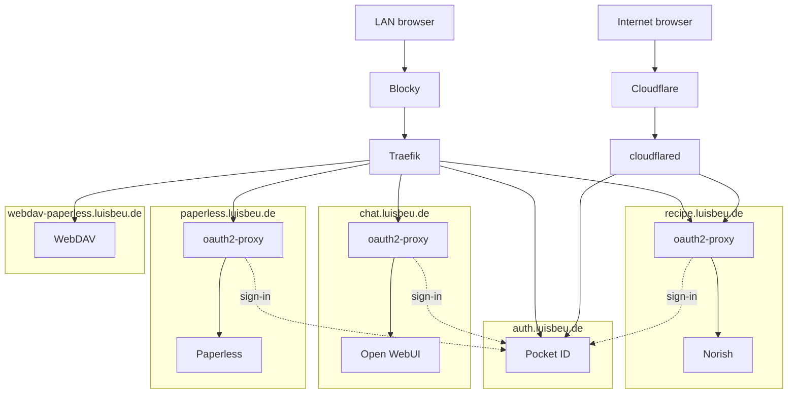

# Helios

Flux GitOps for the Helios single-node k3s cluster. NixOS owns the host (k3s, NVIDIA, CDI), and this repo owns what runs on it.

Flux is bootstrapped once with `--path clusters/helios`, so after that a push and a reconcile apply every change.

## Services

Each service has one rebuild procedure in `docs/`. Flux applies the manifests, so a doc holds only the steps and state that are not in the YAML: tokens, dashboard routes, the host, and claim restores.

| Service | Namespace | Doc |
| --- | --- | --- |
| generic-cdi-plugin | `kube-system` | [docs/generic-cdi-plugin.md](docs/generic-cdi-plugin.md) |
| reloader | `kube-system` | [docs/reloader.md](docs/reloader.md) |
| cert-manager | `cert-manager` | [docs/cert-manager.md](docs/cert-manager.md) |
| cloudflared | `network` | [docs/cloudflared.md](docs/cloudflared.md) |
| blocky | `network` | [docs/blocky.md](docs/blocky.md) |
| ollama | `ai` | [docs/ollama.md](docs/ollama.md) |
| pocket-id | `pocket-id` | [docs/pocket-id.md](docs/pocket-id.md) |
| open-webui | `ai` | [docs/open-webui.md](docs/open-webui.md) |
| paperless | `paperless` | [docs/paperless.md](docs/paperless.md) |
| norish | `norish` | [docs/norish.md](docs/norish.md) |
| oauth2-proxy | `norish`, `paperless`, `ai` | [docs/oauth2-proxy.md](docs/oauth2-proxy.md) |
| velero | `velero` | [docs/velero.md](docs/velero.md) |
| cloudnative-pg | `cnpg-system` | [docs/cloudnative-pg.md](docs/cloudnative-pg.md) |

## Request path

A LAN browser asks Blocky, which answers every published name with this node, so the browser opens Traefik. Traefik sends the Pocket ID host to Pocket ID and the WebDAV host to WebDAV. The Open WebUI, Paperless, and Norish hosts go to that namespace's oauth2-proxy, which proxies to the app. Without a session the gate redirects the browser to Pocket ID, which returns it to `/oauth2/callback` on the same host before the gate proxies to the app. An internet browser reaches Cloudflare and then cloudflared, and the tunnel serves only the Pocket ID host and the Norish gate.



## Operate

Tasks run from this directory. `task` defaults to `/etc/rancher/k3s/k3s.yaml`, which only root can read unless k3s was started with `write-kubeconfig-mode`, so set `KUBECONFIG` otherwise.

```sh
task build        # render layers, HelmReleases, scripts, and SOPS files
task diff         # working tree vs what Flux applied
task reconcile    # fetch HEAD and apply now
task status       # Flux kustomizations and HelmReleases
```

SOPS encrypts to the age key in `.sops.yaml`. The private key is not in this repo, so decrypt and edit need `sops` on `PATH` plus `SOPS_AGE_KEY` or `SOPS_AGE_KEY_FILE`.

```sh
task sops:encrypt -- secrets/<name>.yaml       # write secrets/<name>.enc.yaml, delete plaintext
task sops:edit -- secrets/<name>.enc.yaml       # edit in $EDITOR, re-encrypt
task sops:decrypt -- secrets/<name>.enc.yaml    # print plaintext, write no file
```

A new `*.enc.yaml` also goes into `secrets/kustomization.yaml`.

## Concerns

Each directory holds one kind of object, so new YAML goes in the directory that matches its kind, not the feature it supports.

| Concern | Owns | Does not own |
| --- | --- | --- |
| **Apply graph** | Flux `Kustomization` objects: path, `dependsOn`, decryption | HelmReleases, Secrets, charts |
| **Namespaces** | `Namespace` objects and the `edge` PriorityClass | Anything that lives inside a namespace |
| **Sources** | `HelmRepository` / `OCIRepository` | The HelmReleases that consume them |
| **DNS** | Blocky HelmRelease | The CoreDNS override, chart source, Namespace |
| **Platform** | Cluster operators, the Cloudflare Tunnel, node plugins, the CoreDNS override, Velero, and CloudNativePG | User-facing apps, Blocky, Certificates, Secrets |
| **Apps** | Workload HelmReleases and NetworkPolicies for upstream charts | Chart sources, ClusterIssuers, cluster config |
| **Secrets** | SOPS-encrypted `Secret` manifests (`*.enc.yaml`) | ClusterIssuers, Certificates, plaintext |
| **Certs** | `ClusterIssuer` and `Certificate` | cert-manager itself, Ingress, apps that mount the TLS secret |
| **Charts** | Local Helm chart source in this repo | The HelmRelease that installs the chart |

Flux layers (`clusters/helios/*.yaml`) wire these together without containing the objects they apply.

## Layout

| Path | Concern |
| --- | --- |
| `clusters/helios` | Apply graph, including `flux-system` |
| `namespaces` | `Namespace` objects |
| `sources` | Chart repositories |
| `dns` | Blocky HelmRelease. Applied before the CoreDNS override |
| `platform` | CDI plugin, CoreDNS override, secret reflector, and secret reloader |
| `platform/cert-manager` | cert-manager HelmRelease (own Flux layer so CRDs are Ready before certs) |
| `platform/cloudflared` | cloudflared HelmRelease and its egress allowlist (own Flux layer; waits for the tunnel token) |
| `platform/velero` | Velero schedules and the node agent (own Flux layer; waits for the S3 secret) |
| `platform/cloudnative-pg` | CloudNativePG and the Barman Cloud plugin (own Flux layer; waits for cert-manager) |
| `apps` | Workload HelmReleases and NetworkPolicies for upstream charts |
| `certs` | Let's Encrypt `ClusterIssuer` and `Certificate` |
| `secrets` | Matches `.sops.yaml`; commit only `*.enc.yaml` |
| `charts/generic-cdi-plugin` | Chart for the CDI plugin; the release lives in `platform` |
| `charts/paperless` | Chart for Paperless-ngx; the release lives in `apps` |
| `charts/pocket-id` | Chart for Pocket ID; the release lives in `apps` |
| `charts/norish` | Chart for Norish; the release lives in `apps` |
| `charts/oauth2-proxy` | Chart for the Pocket ID session gate; the releases live in `apps` |
| `docs` | Rebuild procedure and docs for each service |
| `Taskfile.yml` | `build`, `diff`, `reconcile`, `status`, `sops:encrypt`, `sops:edit`, `sops:decrypt`, `backup:restore` |

## Apply order

`GitRepository` `flux-system` syncs this repo. `clusters/helios` points Flux at:

1. **namespaces** — names exist before anything targets them
2. **sources** — chart repos; no dependencies
3. **dns** — Blocky. Waits for namespaces and sources
4. **platform** — CDI plugin, CoreDNS override, the secret reflector, and the secret reloader. Waits for dns
5. **cert-manager** — waits for namespaces and sources, then the operator
6. **cloudnative-pg** — waits for namespaces, sources, and cert-manager, then the operator and the Barman Cloud plugin
7. **secrets** — waits for namespaces, then decrypts SOPS
8. **certs** — waits for namespaces, cert-manager, and secrets, then requests certificates
9. **apps** — waits for namespaces, sources, platform, certs, secrets, and cloudnative-pg, then workloads
10. **cloudflared** — waits for namespaces, sources, and secrets, then the remotely managed tunnel
11. **backups** — waits for namespaces and secrets, then Velero

Apps that mount the TLS secret wait for **certs**, and apps that read SOPS secrets wait for **secrets**. Backups do not gate apps.

## Rebuild

A lost cluster is rebuilt in this order:

1. Bring the NixOS host back: k3s, NVIDIA, the CDI spec the generic-cdi-plugin chart mounts, and this node's LAN address.
2. Bootstrap Flux:

    ```sh
    flux bootstrap github \
      --owner=Beuterei \
      --repository=helios \
      --branch=main \
      --path=clusters/helios \
      --personal
    ```

3. Create Secret `flux-system/sops-age` with data key `age.agekey` (the age private key). The public key is in `.sops.yaml`, and the secrets in git decrypt with that key, so keep them when restoring claims.
4. `task reconcile`, then `task status`.
5. Follow the service docs in [Services](#services) for anything still outside git. Restore claim data once `velero` is Ready and the claims are Bound.
